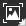
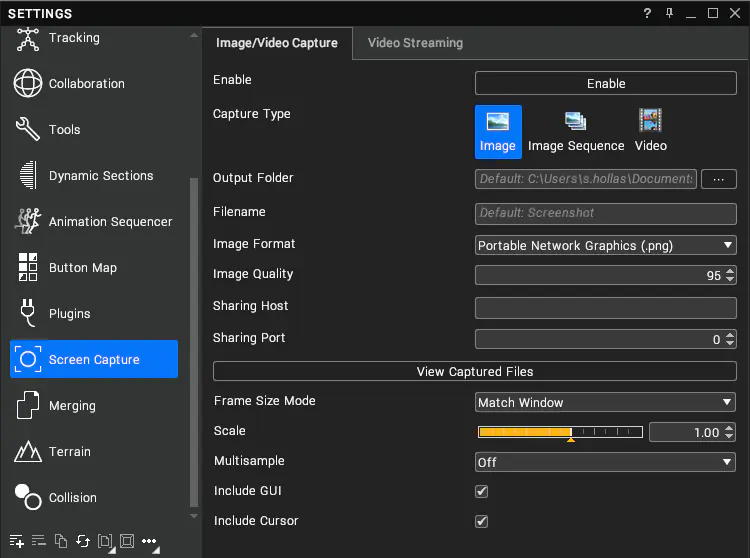

# Screen Capture

The screen capture tool can take screenshots and record video of the GUI and 3D scene.

It can be accessed from the  button in the Toolbar. Click on the button to capture the screen in the current screen capture mode, or right-click on it to change the capture mode or open the Settings window.

## Settings

Right-click on the Toolbar button and select **Settings...** or open the Settings window and navigate to **Screen Capture** to configure the tool.

### Output

| Setting             | Description                                                                                                                   |
|---------------------|-------------------------------------------------------------------------------------------------------------------------------|
| Capture Type        | Capture the screen as an Image, Image Sequence, or Video.                                                                     |
| Directory           | Directory to save captured images and videos to. The default location is **Documents**\\**VisionaryRender**\\**Screenshots**. |
| Filename            | Name of the captured file. This is suffixed with the current date, time, frame, and channel.                                  |
| Sharing Host        | IP address of the sharing host.                                                                                               |
| Sharing Port        | Port number to connect to the sharing host on.                                                                                |

### Format & Quality

| Setting             | Description                                                                                                                   |
|---------------------|-------------------------------------------------------------------------------------------------------------------------------|
| Image Format        | File format to output when saving images.                                                                                     |
| Video Format        | File format to output when saving video.                                                                                      |
| Video Bit Rate      | Target bit rate for video compression in kbps.                                                                                |
| Image Quality       | Quality of image compression (Note: this only applies to lossy formats like JPEG).                                            |
| Framerate           | Framerate of image sequences and videos in frames per second.                                                                 |
| Max Capture Length  | Maximum image sequence or video capture duration. Set to zero for no limit.                                                   |
| Resolution          | How to determine the size of the captured frame.                                                                              |
| Custom Resolution   | Size of the captured frame in pixels.                                                                                         |
| Scale               | Scale of the captured image – i.e. a scale of 2 will cause the captured image to be twice the resolution of the screen.       |
| Anti-aliasing       | Enable anti-aliasing for the captured image.                                                                                  |
| Include GUI         | Include the user interface in the screen capture, or just the 3D scene.                                                       |
| Include Cursor      | Include the mouse cursor in the screen capture if it is over the GUI.                                                         |

### Buttons

| Button              | Description                                                                                                              |
|---------------------|--------------------------------------------------------------------------------------------------------------------------|
| Capture             | Capture the screen using the current screen capture mode and settings. This can also be triggered with the `PrtScn` key. |
| View Captured Files | Reveal the output directory of captured files in Explorer.                                                               |
